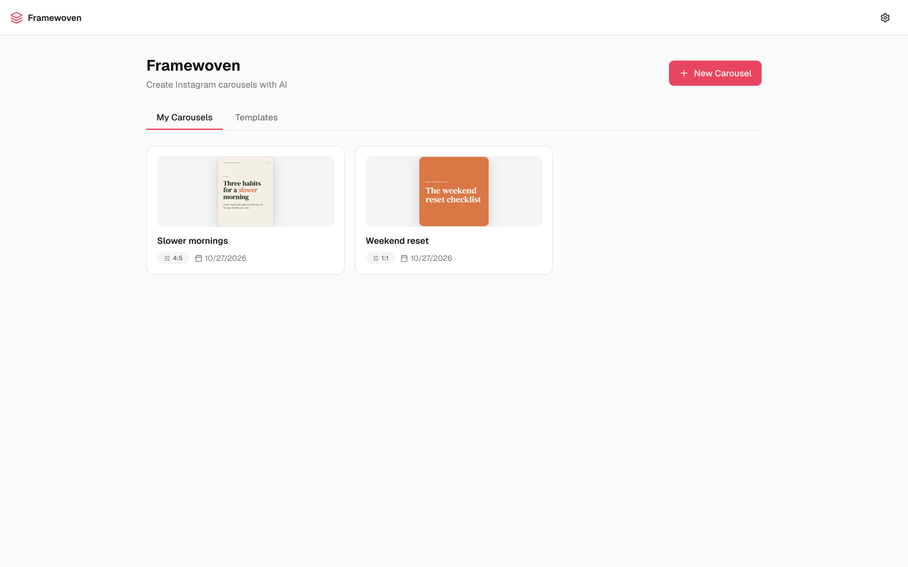
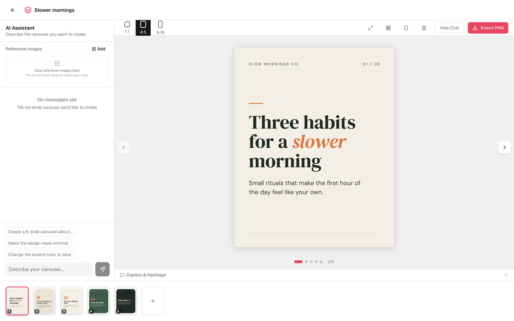
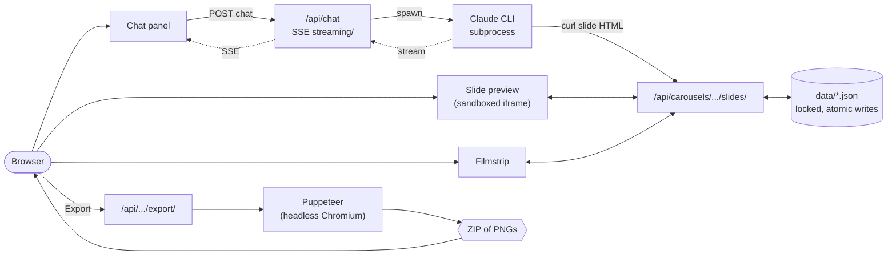

<div align="center">

# Framewoven

### An AI-powered creative studio for branded social content.

**Chat with Claude. Design on-brand Instagram carousels. Export pixel-exact PNGs.**

[](./LICENSE)
[](https://github.com/manishkumarglobal/framewoven/actions/workflows/ci.yml)
[](https://nextjs.org)
[](https://react.dev)
[](https://www.typescriptlang.org)



</div>

---

## What is Framewoven?

Framewoven is a local-first, AI-assisted tool for creating branded carousel content.
You describe what you want in a chat panel, and a Claude design agent writes each slide as HTML and CSS using your brand's colors, fonts, and style.
Slides render live in the editor and export as PNGs at Instagram's exact pixel dimensions.

The app runs on your own machine.
Your carousels, brand settings, and uploads are plain files in the project folder, with no app accounts and no cloud storage.
The design agent is Claude, so each chat request sends your message, brand settings, and the open carousel's slides to Anthropic through your Claude Code account.

## Table of contents

- [What you can do today](#what-you-can-do-today)
- [Requirements](#requirements)
- [Install and run](#install-and-run)
- [Your data](#your-data)
- [How the design agent works](#how-the-design-agent-works)
- [Slash commands and scripts](#slash-commands-and-scripts)
- [Architecture](#architecture)
- [Project structure](#project-structure)
- [Troubleshooting](#troubleshooting)
- [Planned capabilities](#planned-capabilities)
- [Contributing](#contributing)
- [Origin and license](#origin-and-license)

---

## What you can do today



- **Design slides by chatting.**
  The editor's chat panel sends your request to a Claude design agent, which creates, rewrites, or deletes slides in the open carousel.
  Ask for a whole carousel, or name a slide to change ("make slide 3 more minimal").
  Replies arrive one complete message at a time, and new slides appear in the filmstrip as the agent saves them.
- **HTML and CSS slides.**
  Each slide is real HTML and CSS, rendered in a sandboxed iframe for preview and screenshotted by the same rendering code for export, so the preview matches the PNG.
- **Brand configuration.**
  A setup dialog saves your brand name, five colors, heading and body fonts from a curated list of Google Fonts, an optional logo, and style keywords.
  Once a brand name is set, every chat request gives these to the design agent.
- **Brand fonts in preview and export.**
  Preview loads fonts from Google Fonts, and export embeds them into each slide so the PNGs use the real typefaces.
- **Three Instagram formats.**
  Each carousel is 1:1 (1080x1080), 4:5 (1080x1350, the default), or 9:16 (1080x1920).
  You choose the format when creating a carousel and can change it from the editor toolbar.
  Changing it does not reflow slides that were designed for the previous format.
- **Reference images.**
  Attach PNG, JPG, or WebP images in the chat panel, and the design agent can open them to match their style.
- **Reorder and undo.**
  Drag slides in the filmstrip to reorder them.
  Each slide keeps its last five versions, and its Undo button steps back one version at a time.
- **Templates.**
  Save a carousel as a template from the editor toolbar, then start new carousels from it in the dashboard's Templates tab.
- **Duplicate carousels** from the dashboard.
- **Safe-zone overlay** on the editor preview, showing where Instagram's profile-grid crop and on-screen controls cover the slide.
- **Full-window preview** that steps through slides with the arrow keys.
- **Captions and hashtags.**
  Ask the design agent for a caption, and it saves the caption and hashtags to the carousel, where the editor shows them with copy buttons.
- **PNG export.**
  The Export button renders every slide in headless Chromium at the carousel's exact dimensions and downloads them as a ZIP.
  If an export fails, the editor tells you what went wrong.

## Requirements

- **Node.js 20 or later**, with npm.
- **Git**, to clone the repository.
- **Claude Code**, installed and signed in, for the design agent.
  Framewoven runs the `claude` command-line tool on your machine, so the agent uses your existing Claude Code account and its usage limits.
  Install it from the [Claude Code documentation](https://docs.anthropic.com/en/docs/claude-code), then run `claude` once to sign in.
  Each chat request is capped at USD 1.00 of Claude usage.
- **About 300 MB of disk space** for the Chromium build that PNG export uses, downloaded during setup.

Framewoven runs on macOS, Linux, and Windows.

Without Claude Code, the app still opens and you can set up your brand, manage carousels and templates, reorder and undo slides, and export existing slides.
You cannot create new slide content, because slides are written by the design agent.

## Install and run

The first setup takes a minute or two while dependencies and Chromium download.
Later launches take seconds.

### With Claude Code (recommended)

```bash
git clone https://github.com/manishkumarglobal/framewoven.git
cd framewoven
claude
```

Then, at the Claude Code prompt:

```
/start
```

`/start` installs dependencies, seeds empty data files, launches the dev server in the background, and opens http://localhost:3000.
Pass a port to use a different one, for example `/start 3001`.
Stop the server with `/stop`.

### Without Claude Code's slash commands

```bash
git clone https://github.com/manishkumarglobal/framewoven.git
cd framewoven
npm run setup
```

`npm run setup` installs dependencies, downloads Chromium, seeds empty data files, looks for the Claude CLI, and then starts the dev server at http://localhost:3000 in the foreground.
Press Ctrl+C to stop it, and run `npm run dev` to start it again later.
To use another port, run `PORT=3001 npm run dev` on macOS or Linux, or `$env:PORT=3001; npm run dev` in Windows PowerShell.

If setup cannot find the Claude CLI, it prints a warning and the app runs without the design agent.
Set `CLAUDE_CLI_PATH` in `.env.local` to the full path of your `claude` executable, then restart the dev server.

## Your data

Application source and your data are kept apart.
Git tracks only the source; everything you create stays local and is ignored by Git.

| Location | Contents |
|---|---|
| `data/brand.json` | Brand configuration |
| `data/carousels.json` | Carousels and their slides, including undo history and captions |
| `data/templates.json` | Saved templates |
| `data/style-presets.json` | Style presets the design agent can save |
| `data/staged-actions.json` | Records for an internal API that the UI does not use yet |
| `data/.font-cache/` | Cached Google Fonts CSS used by export |
| `public/uploads/` | Uploaded logos and reference images |
| `.env.local` | Local configuration, such as `CLAUDE_CLI_PATH` |

Chat transcripts are stored in your browser's local storage for each carousel.
Claude Code also keeps its own record of each design-agent session in its data directory, outside this project.
Exports are not stored; each export is built in memory and downloaded as a ZIP.

Updating Framewoven with `git pull` does not touch these files.
To back up your work, copy `data/`, `public/uploads/`, and `.env.local`.
`/reset` deletes your carousels, templates, brand, style presets, and uploads and re-seeds empty defaults, after asking for confirmation.
It does not touch browser local storage or Claude Code's session records.

## How the design agent works

When you send a chat message, `/api/chat` starts the Claude CLI as a subprocess with `--allowedTools Bash WebFetch Read` and streams its replies back to the browser as Server-Sent Events.
The agent's system prompt includes your brand configuration, the open carousel's slides, and the address of this running app.

The agent then works through the app's own API:

1. It writes each slide as body-level HTML and CSS.
2. It saves the slide by calling `/api/carousels/[id]/slides` with `curl`, through its `Bash` tool.
3. The editor refreshes while the agent works, so new and changed slides appear in the filmstrip.

`WebFetch` lets the agent research a topic while designing, and `Read` lets it open your reference images.

### From slide to PNG

Slides are stored as body-level HTML, without `<html>`, `<head>`, or `<!DOCTYPE>`.
`wrapSlideHtml()` in [`src/lib/slide-html.ts`](./src/lib/slide-html.ts) wraps that body into a full document with font loading and fixed dimensions.
The same function feeds both the sandboxed preview iframe and the Puppeteer export, which screenshots each slide at its exact pixel size.

## Slash commands and scripts

Inside Claude Code:

| Command | What it does |
|---|---|
| `/start [port]` | Set up if needed, launch the dev server in the background, and open the browser. Safe to re-run. |
| `/stop [port]` | Stop the server listening on that port, 3000 by default. |
| `/reset` | Delete local carousels, templates, brand, and uploads, then re-seed defaults. Asks first. |
| `/doctor` | Check Node, the Claude CLI, dependencies, data files, and port 3000. |

From a terminal:

| Script | What it does |
|---|---|
| `npm run setup` | Install dependencies and Chromium, seed data, find the Claude CLI, then start the dev server. |
| `npm run dev` | Start the dev server. |
| `npm run build` / `npm start` | Build and run a production server. |
| `npm run doctor` | Run the environment check; works before `npm install`. |
| `npm run typecheck`, `npm run lint`, `npm test`, `npm run build` | The quality gate CI runs on every pull request. |

## Architecture



- **Local-first and single-user.** A localhost web app reading and writing local files, with no database and no app accounts. Its outside dependencies are Claude Code for the design agent and Google Fonts for typefaces.
- **Claude CLI as the agent.** The agent reuses your Claude Code sign-in instead of requiring a separate API key.
- **Slides as HTML.** HTML and CSS are more expressive than a canvas or a layout DSL, and the same markup drives preview and export.
- **Sandboxed preview.** Preview iframes use `sandbox=""`, so slide markup cannot run scripts in the editor.
- **JSON storage with locking.** All reads and writes go through [`src/lib/data.ts`](./src/lib/data.ts), which serializes changes per file and writes atomically, and refuses to overwrite a file that no longer parses.

[`CLAUDE.md`](./CLAUDE.md) documents the architecture and conventions for AI assistants working on this codebase.

## Project structure

```
framewoven/
├── .claude/commands/     Claude Code slash commands: /start, /stop, /reset, /doctor
├── .github/workflows/    CI: typecheck, lint, test, build
├── data/                 Your data (ignored by Git)
├── docs/                 Maintainer guide, provenance, screenshots
├── public/uploads/       Your uploads (ignored by Git)
├── scripts/              setup, dev-server launcher, doctor
├── src/
│   ├── app/              Pages and API routes
│   ├── components/       Brand, chat, editor, layout, template, and UI components
│   ├── lib/              Storage, rendering, export, system prompt, Claude CLI discovery
│   └── types/            Shared TypeScript types
└── tests/                Vitest suites
```

## Troubleshooting

**`/start` or `npm run doctor` says Node is too old.**
Install Node 20 or later from [nodejs.org](https://nodejs.org) or with [nvm](https://github.com/nvm-sh/nvm).

**The chat panel says to connect the Claude CLI.**
Install Claude Code and sign in by running `claude` once.
Setup looks for `claude` in `~/.local/bin`, `/usr/local/bin`, `/opt/homebrew/bin`, `~/.npm-global/bin`, and on your `PATH`; on Windows it also checks the npm and Programs folders.
If yours is elsewhere, set `CLAUDE_CLI_PATH` in `.env.local` and restart the dev server.
On Windows, `where claude` in PowerShell shows the path.

**Port 3000 is in use.**
Run `/stop` if it is a previous Framewoven server, or use another port with `/start 3001` or the `PORT` setting shown in [Install and run](#install-and-run).

**Export fails.**
The editor shows the reason.
If Chromium is missing or fails to launch, re-run `npm run setup`, which downloads Chromium and test-launches it.
On Linux you may need Chromium's system libraries, such as `libnss3`, `libatk1.0-0`, and `libxss1`.

**Generated slides ignore my brand.**
Open brand setup with the gear icon and confirm a brand name, colors, and style keywords are saved.
Brand details reach the design agent only when a brand name is set.

**Something else.**
Run `/doctor` or `npm run doctor` for an environment check, and [open an Issue](https://github.com/manishkumarglobal/framewoven/issues) if the problem persists.

## Planned capabilities

These are planned directions, not shipped features.
Each will be tracked as an Issue and listed in the [changelog](./CHANGELOG.md) only when released.

- **Multiple independent brand profiles**, so one installation can serve several brands.
- **LinkedIn-ready PDF exports** for document-style carousel posts.
- **Improved content workflows** for planning and iterating on a series of posts.
- **Reusable branded templates** that carry a brand's layout system, beyond today's saved-carousel templates.
- **Additional platform support** beyond Instagram's formats.

## Contributing

Framewoven follows a no-ticket, no-work process: open an Issue first for anything material, and reference it from your pull request with `Closes #N`.
Before opening a pull request, run the full gate:

```bash
npm run typecheck && npm run lint && npm test && npm run build
```

[`docs/MAINTAINING.md`](./docs/MAINTAINING.md) covers branching, review, testing, changelog, and release practice.
[`CLAUDE.md`](./CLAUDE.md) covers code conventions, including the slide rendering contract between preview and export.

## Origin and license

Framewoven was originally derived from [Open Carrusel](https://github.com/Hainrixz/open-carrusel), an MIT-licensed project, through a maintained fork.
It is now independently maintained.
Its Git history, original authorship, and the original copyright notice are preserved.
See [`docs/PROVENANCE.md`](./docs/PROVENANCE.md) for the source baseline, attribution, and historical records.

Framewoven is released under the [MIT License](./LICENSE).
